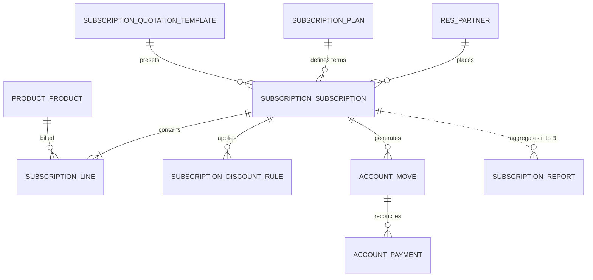

# Brightloop Subscription Management System

[](https://www.odoo.com/)
[](LICENSE)
[]()
[-orange.svg)]()

An enterprise-grade Subscription Management System built for **Brightloop Software** on **Odoo 17.0**. This solution automates the full quote-to-cash lifecycle for B2B recurring SaaS and service contracts—from customer onboarding, quotation templates, and contract lifecycle management, to automated recurring billing, promotional/volume discounts with auto-cessation, real-time payment reconciliation, and executive MRR/ARR analytics.

---

## Table of Contents

1. [Project Overview](#project-overview)
2. [Key Features & Capabilities](#key-features--capabilities)
3. [Architecture & Data Models](#architecture--data-models)
4. [Security & Access Control](#security--access-control)
5. [Prerequisites & System Requirements](#prerequisites--system-requirements)
6. [Installation & Setup Procedure](#installation--setup-procedure)
7. [Running Automated Tests](#running-automated-tests)
8. [End-to-End User Guide & Workflows](#end-to-end-user-guide--workflows)
9. [Module Structure](#module-structure)
10. [License & Acknowledgements](#license--acknowledgements)

---

## Project Overview

Brightloop Software provides recurring SaaS products, support plans, and consulting subscriptions. Prior to this module, recurring billing, contract tracking, and payment reconciliations required manual intervention, leading to billing delays, revenue leakage, and fragmented reporting.

This module delivers:
- **Zero-Friction Sales**: Standardized quotation templates to convert leads to active subscriptions in one click.
- **Automated Billing Engine**: Daily scheduled crons and manual batch wizards that generate draft invoices in advance without locking records.
- **Smart Discount Engine**: Promotional and volume-tiered discounts that automatically cease after a specified number of billing cycles.
- **Real-Time Payment Tracking**: Instant visibility into invoice settlement, payments received, and overdue balances.
- **Executive BI Reporting**: High-performance SQL analytical view (`subscription.report`) calculating normalized Monthly Recurring Revenue (MRR) and Annual Recurring Revenue (ARR) across diverse billing frequencies.

---

## Key Features & Capabilities

### 1. Customer Segmentation & Product Catalog
- **Subscription Customer Flag**: `is_subscription_customer` on `res.partner` with dedicated list and search filters.
- **Subscription Products**: Dedicated `is_subscription` toggle on `product.template` and variants for services and recurring software licenses.
- **Flexible Pricing Plans (`subscription.plan`)**:
  - Billing Cycle Units: **Daily**, **Weekly**, **Monthly**, **Yearly**.
  - Custom Intervals (e.g., quarterly = `monthly` × `3`).
  - Minimum commitment quantity validation.
  - Configurable auto-close grace period (days).

### 2. Quotation Templates & Contract Lifecycle
- **Quotation Templates (`subscription.quotation.template`)**: Pre-populate contract lines, plans, terms, and default quantities.
- **Subscription Lifecycle Management (`subscription.subscription`)**:
  - Sequential ID generation (`SUB/YYYY/00001`).
  - States: `Draft` ➔ `In Progress` ➔ `Closed` / `Cancelled`.
  - Comprehensive chatter audit trail (`mail.thread`, `mail.activity.mixin`).

### 3. Automated Recurring Billing Engine
- **Advance Invoicing Scheduling**: Automatically calculates `next_invoice_date` factoring in `advance_invoice_days`.
- **Automated Background Cron (`ir_cron_subscription_billing`)**: Daily background worker identifying due contracts and generating draft customer invoices (`account.move`).
- **Manual Batch Billing Wizard (`subscription.billing.wizard`)**: On-demand mass billing wizard filterable by plan and cut-off date with one-click invoice generation.
- **Bi-Directional Invoice Sync**: Invoices link to subscription contracts, tracking invoice state changes and updating next billing dates.

### 4. Promotional & Volume Discount Rules with Auto-Cessation
- **Multi-Type Discount Rules (`subscription.discount.rule`)**:
  - **Percentage Discount** (e.g., 20% off).
  - **Fixed Amount Discount** (e.g., $50 off).
  - **Tiered Volume Discount** (e.g., 10% off for 10+ seats, 20% off for 50+ seats).
- **Rule Stacking Logic**: Choose between `combined` (additive) or `max` (best customer discount).
- **Automatic Cessation**: Enforce promotional durations (e.g., first 3 cycles only) with automated cycle counter incrementing (`applied_cycles_count`) and auto-removal upon expiration.
- **Privilege Separation**: Restricted to Subscription Managers to protect pricing margins.

### 5. Payment Reconciliation, Renewal & Expiry
- **Real-Time Payment Status**: Computes `payment_status` (`draft`, `pending`, `partial`, `paid`, `overdue`), `paid_amount`, and `amount_due`.
- **Reconciled Payments Smart Button**: Inspects related invoice move lines to surface matching `account.payment` records directly on the contract.
- **One-Click Renewal (`action_renew`)**: Creates a renewed subscription linked to the previous contract, carrying forward customer, plan, and lines.
- **Auto-Closure Expiry Cron (`ir_cron_subscription_contract_expiries`)**: Background scheduler identifying expired contracts past their plan grace period and setting them to `Closed`.

### 6. Executive Analytics & BI Dashboard
- **MRR & ARR Normalization**: Automatically normalizes revenue regardless of billing frequency:
  $$\text{Monthly: } \text{MRR} = \frac{\text{Net Amount}}{\text{Interval}}, \quad \text{ARR} = \text{MRR} \times 12$$
  $$\text{Yearly: } \text{MRR} = \frac{\text{Net Amount}}{12 \times \text{Interval}}, \quad \text{ARR} = \frac{\text{Net Amount}}{\text{Interval}}$$
  $$\text{Weekly: } \text{MRR} = \frac{\text{Net Amount} \times 52}{12 \times \text{Interval}}, \quad \text{ARR} = \frac{\text{Net Amount} \times 52}{\text{Interval}}$$
  $$\text{Daily: } \text{MRR} = \frac{\text{Net Amount} \times 30}{\text{Interval}}, \quad \text{ARR} = \frac{\text{Net Amount} \times 365}{\text{Interval}}$$
- **Dedicated SQL View (`subscription.report`)**: Non-stored database view (`_auto = False`) aggregating contract data with zero locking overhead.
- **Interactive Visualizations**: Pivot matrices (slice-and-dice by Customer, Plan, State, Payment Status) and bar/pie graphs.
- **Dedicated Reporting Menu**: Accessible directly under `Subscriptions > Reporting > Subscription Analytics`.

---

## Architecture & Data Models



### Models Summary

| Model Identifier | Description | Technical Details |
| :--- | :--- | :--- |
| `subscription.subscription` | Core recurring contract | State machine (`draft`, `in_progress`, `closed`, `cancelled`), revenue calculation, invoice & payment linkages |
| `subscription.line` | Contract line items | Linked to `product.product`, price unit, quantity, subtotal |
| `subscription.plan` | Recurring pricing plans | Recurrence units (daily, weekly, monthly, yearly), billing intervals, grace period |
| `subscription.quotation.template` | Contract templates | Pre-configured lines and plans for quick sales dispatch |
| `subscription.discount.rule` | Promotional & volume discounts | Percentage, fixed, or volume tiers with cycle-based auto-cessation |
| `subscription.billing.wizard` | Batch invoicing wizard | Transient model (`models.TransientModel`) for mass-generating due invoices |
| `subscription.report` | Analytical BI report | Database SQL View (`_auto = False`) providing aggregate metrics (MRR, ARR, Contract Count) |
| `res.partner` | Extended customer model | Added `is_subscription_customer` flag and contract count smart buttons |
| `product.template` | Extended product model | Added `is_subscription` service/goods flag |
| `account.move` | Extended invoice model | Links invoice back to `subscription_id` |

---

## Security & Access Control

Access control follows the principle of least privilege, providing two role tiers:

### 1. Subscription User (`group_subscription_user`)
- **Target Persona**: Sales Representatives and Account Executives.
- **Permissions**:
  - Full read/write/create on Subscriptions, Lines, Customers, and Quotation Templates.
  - Read access to Plans, Discounts, and Analytical Reports (`subscription.report`).
  - Read access to generated customer invoices.
  - Restricted from modifying discount rules or plan pricing structures.

### 2. Subscription Manager (`group_subscription_manager`)
- **Target Persona**: Sales Directors, Finance Leads, and System Administrators.
- **Permissions**:
  - Full CRUD access over all subscription models.
  - Configure Subscription Plans and Pricing structures.
  - Create, approve, and adjust Promotional and Volume Discount Rules.
  - Execute manual batch billing wizards and trigger cron tasks.
  - Full access to executive reporting dashboards.

### Record Rules & Multi-Company Support
- **Multi-Company Separation**: Contracts and invoices enforce multi-company boundaries:
  - `['|', ('company_id', '=', False), ('company_id', 'in', company_ids)]`

---

## Prerequisites & System Requirements

- **Odoo**: Version 17.0 Community or Enterprise
- **Python**: Version 3.10 or 3.11
- **Database**: PostgreSQL 13, 14, 15, or 16
- **Standard Odoo Dependencies**:
  - `base`
  - `product`
  - `account`
  - `mail`
  - `portal`

---

## Installation & Setup Procedure

### Step 1: Clone the Repository
Clone the repository into your custom Odoo addons directory:

```bash
cd /path/to/odoo/custom_addons
git clone https://github.com/ashikthanzeer/odoo-hackathon.git
```

### Step 2: Configure `addons_path`
Ensure your `odoo.conf` file includes the path to this repository:

```ini
[options]
addons_path = /path/to/odoo/addons,/path/to/odoo/custom_addons/odoo-hackathon
```

### Step 3: Install the Module via CLI or Web Client

#### Option A: Command Line Installation (Recommended for Developers)
Restart your Odoo instance and update the database:

```bash
odoo-bin -c /path/to/odoo.conf -d <your_database_name> -i brightloop_subscription --stop-after-init
```

#### Option B: Web Client Installation
1. Log in to your Odoo instance as an Administrator (`admin`).
2. Activate **Developer Mode** (`Settings > Developer Tools > Activate the developer mode`).
3. Navigate to **Apps > Update Apps List** and click **Update**.
4. In the Apps search bar, search for `Brightloop Subscription Management`.
5. Click **Activate / Install**.

---

## Running Automated Tests

The module includes a comprehensive test suite (9 test modules) covering security, pricing, templates, billing crons, discount auto-cessation, payment reconciliation, and MRR normalization.

### Run All Module Tests via CLI

```bash
odoo-bin -c /path/to/odoo.conf -d <test_db> -i brightloop_subscription --test-enable --stop-after-init
```

### Run a Specific Test Suite

```bash
# Test Billing Engine & Automated Crons
odoo-bin -c /path/to/odoo.conf -d <test_db> --test-tags /brightloop_subscription:TestBillingEngine --stop-after-init

# Test Discount Rules & Auto-Cessation
odoo-bin -c /path/to/odoo.conf -d <test_db> --test-tags /brightloop_subscription:TestDiscountRules --stop-after-init

# Test Payment Reconciliation & Renewals
odoo-bin -c /path/to/odoo.conf -d <test_db> --test-tags /brightloop_subscription:TestPaymentReconciliation --stop-after-init

# Test Analytics & MRR/ARR Normalization
odoo-bin -c /path/to/odoo.conf -d <test_db> --test-tags /brightloop_subscription:TestSubscriptionAnalytics --stop-after-init
```

### Standalone Python Syntax Compilation Check

```bash
python3 -m py_compile \
  brightloop_subscription/models/*.py \
  brightloop_subscription/wizard/*.py \
  brightloop_subscription/tests/*.py \
  brightloop_subscription/__manifest__.py \
  brightloop_subscription/__init__.py
```

---

## End-to-End User Guide & Workflows

### 1. Setting Up Products & Plans
1. Navigate to **Subscriptions > Configuration > Subscription Plans**.
2. Click **New** and define:
   - **Plan Name**: e.g., `Enterprise Monthly Cloud`.
   - **Billing Cycle**: Select `Monthly` with an interval of `1`.
   - **Advance Invoice Days**: e.g., `5` days before the period begins.
   - **Auto-Close Grace Period**: e.g., `15` days.
3. Navigate to **Subscriptions > Configuration > Subscription Products**.
4. Create a product (e.g., `Cloud Hosting Seat`), set Type to `Service`, and ensure `Is a Subscription` is checked.

### 2. Creating Quotations from Templates
1. Navigate to **Subscriptions > Configuration > Quotation Templates**.
2. Create a template (e.g., `Standard SaaS Onboarding`) pre-populating standard seat counts, products, and terms.
3. Navigate to **Subscriptions > Subscriptions > Quotations**.
4. Click **New**, select a Customer and the Quotation Template. Notice how all lines, plans, and terms populate instantly.
5. Click **Confirm / Start Subscription** to transition the record to `In Progress`. The system assigns an official sequence number (e.g., `SUB/2026/00001`).

### 3. Generating Recurring Invoices
- **Automated Workflow**:
  - The background cron job `Subscription Management: Generate Recurring Invoices` runs automatically every night.
  - It queries all active contracts where `next_invoice_date <= today + advance_invoice_days` and creates draft customer invoices.
- **Manual Batch Workflow**:
  - Navigate to **Subscriptions > Subscriptions > Batch Invoicing**.
  - Select an optional Plan filter and Billing Cut-off Date.
  - Click **Generate Invoices**. A notification displays the total count of invoices created.

### 4. Applying Promotional Discounts with Auto-Cessation
1. Navigate to **Subscriptions > Configuration > Discount Rules** (Manager access required).
2. Create a rule:
   - **Name**: `Launch Promo - 3 Months 20% Off`.
   - **Discount Type**: `Percentage` (`20.0%`).
   - **Maximum Duration (Cycles)**: `3`.
3. Link the rule to a contract.
4. Each time the contract is billed:
   - The invoice displays the line item discount.
   - The cycle counter increments (`applied_cycles_count: 1/3`, `2/3`, `3/3`).
   - Upon the 4th billing cycle, the discount rule automatically detaches, returning pricing to the standard rate.

### 5. Tracking Payments & Reconciliations
1. On any active subscription form, inspect the **Payment Status** badge (`Draft`, `Pending`, `Partial`, `Paid`, or `Overdue`).
2. When customer payments are recorded against the linked invoices in Odoo Accounting:
   - `paid_amount` and `amount_due` recalculate automatically.
   - Click the **Payments** smart button to view the reconciled `account.payment` vouchers.

### 6. Contract Renewals & Expiries
- **Contract Renewal**:
  - Click **Renew Subscription** on an active or expiring contract.
  - A new linked contract is drafted with start date set to the previous contract's end date.
- **Grace Period Expiry**:
  - If a contract ends and remains unpaid beyond the plan's grace period, the cron job `Subscription Management: Process Contract Expiries` automatically transitions the contract to `Closed`.

### 7. Executive Analytics & Reporting
1. Navigate to **Subscriptions > Reporting > Subscription Analytics**.
2. **Pivot View**: Group by `Plan`, `Customer`, or `Billing Cycle Unit` along rows and columns, with metrics:
   - `MRR` (Monthly Recurring Revenue)
   - `ARR` (Annual Recurring Revenue)
   - `Net Amount`
   - `Subscription Count`
3. **Graph View**: Toggle between Bar, Line, and Pie charts to visualize revenue growth, active subscriber distributions, and churn trends.

---

## Module Structure

```text
odoo-hackathon/
├── LICENSE
├── README.md
├── Subscription_Management_System.pdf
└── brightloop_subscription/
    ├── __init__.py
    ├── __manifest__.py
    ├── data/
    │   ├── subscription_cron.xml               # Recurring billing & expiry schedulers
    │   └── subscription_sequence.xml           # Contract sequence definition
    ├── demo/
    │   └── subscription_demo.xml               # Sample plans, products & contracts
    ├── models/
    │   ├── __init__.py
    │   ├── account_move.py                     # Invoice linkage & status sync
    │   ├── product_template.py                 # Subscription product flags
    │   ├── res_partner.py                      # Subscription customer flags & counters
    │   ├── subscription.py                     # Core contract lifecycle & revenue engine
    │   ├── subscription_discount_rule.py       # Promotional/volume discount engine
    │   ├── subscription_line.py                # Contract line items
    │   ├── subscription_plan.py                # Billing cycle configurations
    │   ├── subscription_quotation_template.py  # Quotation templates
    │   └── subscription_report.py              # Analytical SQL View BI model
    ├── security/
    │   ├── ir.model.access.csv                 # Model permissions matrix
    │   └── subscription_security.xml           # Security groups & multi-company rules
    ├── tests/
    │   ├── __init__.py
    │   ├── test_billing_engine.py              # Billing cron & invoice generation tests
    │   ├── test_customer_auth.py               # Partner flags & security tests
    │   ├── test_discount_rules.py              # Discount calculation & cessation tests
    │   ├── test_payment_reconciliation.py      # Payment tracking & renewal tests
    │   ├── test_quotation_template.py          # Template instantiation tests
    │   ├── test_subscription_analytics.py      # MRR/ARR & BI SQL view tests
    │   ├── test_subscription_lifecycle.py      # State transitions & sequence tests
    │   ├── test_subscription_plan.py           # Plan validation & constraints tests
    │   └── test_subscription_product.py        # Product configuration tests
    ├── views/
    │   ├── account_move_views.xml              # Invoice form extensions
    │   ├── product_views.xml                   # Product form & search extensions
    │   ├── res_partner_views.xml               # Partner form & filter extensions
    │   ├── subscription_billing_wizard_views.xml # Manual billing wizard view
    │   ├── subscription_discount_rule_views.xml# Discount rule management views
    │   ├── subscription_menus.xml              # Navigation hierarchy & root menus
    │   ├── subscription_plan_views.xml         # Plan configuration views
    │   ├── subscription_quotation_template_views.xml # Template views
    │   ├── subscription_report_views.xml       # Pivot, Graph & Search analytics views
    │   └── subscription_views.xml              # Contract form, tree, search & kanban views
    └── wizard/
        ├── __init__.py
        └── subscription_billing_wizard.py      # Batch billing wizard model
```

---

## License & Acknowledgements

- **License**: Distributed under the [GNU Lesser General Public License v3.0 (LGPL-3)](LICENSE).
- **Author**: Brightloop Software / Odoo Hackathon Team.
- Built strictly following Odoo development best practices, PEP 8 styling conventions, and spec-driven engineering.
